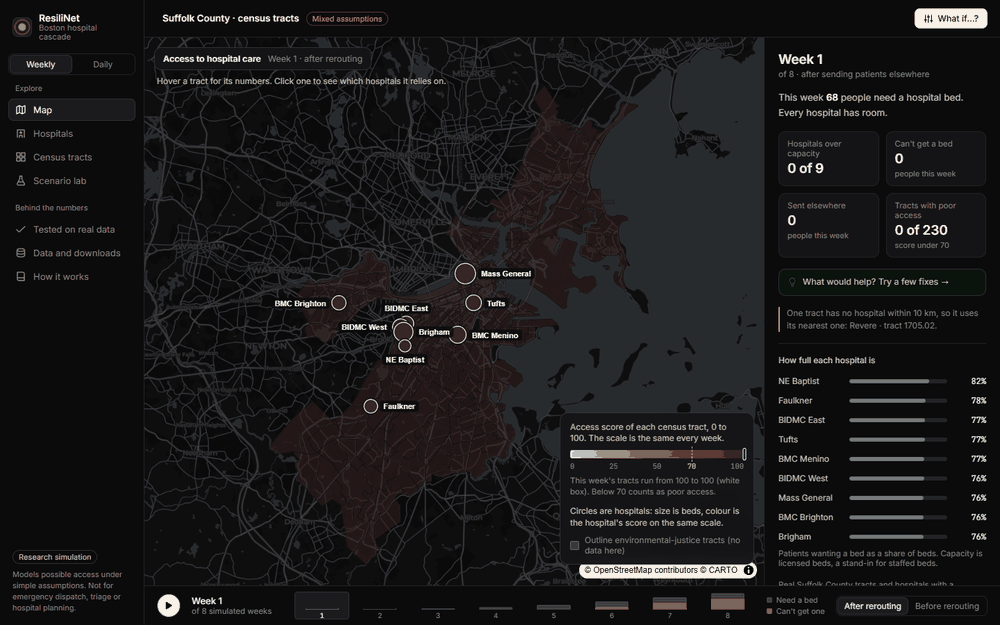
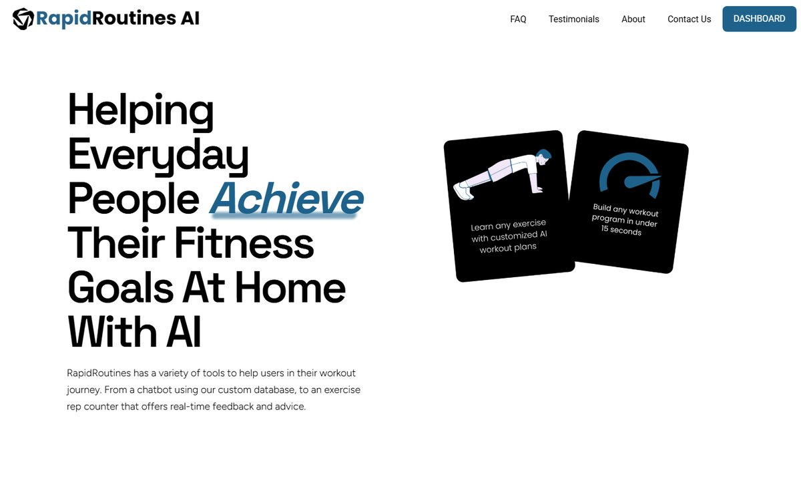
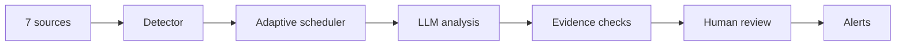
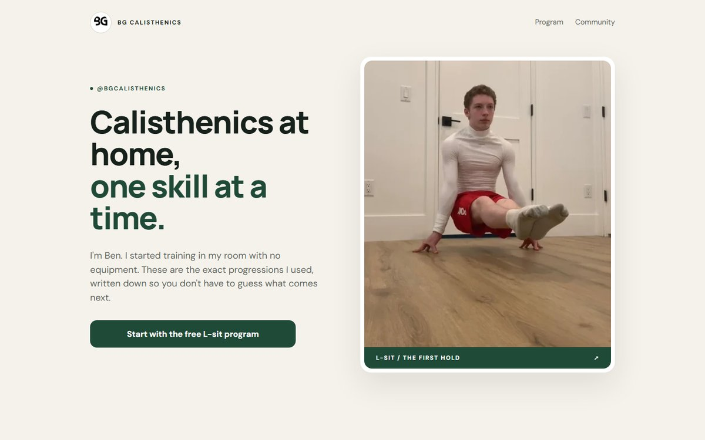

<div align="center">


<a href="https://github.com/benjivolt"></a>

<p>
  <a href="https://rapidroutines.org"></a>
  <a href="https://resilinet-gztw.onrender.com/"></a>
  <a href="https://www.bgcalisthenics.com/"></a>
</p>

</div>

## 👋 About me

```python
class Ben:
    school    = "Boston University, B.A. Mathematics & Computer Science (2030)"
    based_in  = "Boston, MA"
    building  = ["RapidRoutines", "Catalyst Propagation Agent", "ResiliNet"]
    interests = ["full-stack apps", "applied ML", "math modeling", "calisthenics"]

    def now(self):
        return "Open to software engineering and CS + math roles"
```

I build web apps and AI tools end to end, from the database and API to the interface people use. Most of my projects start from something I care about outside of code: calisthenics, biotech, and public health.

## 🚀 Featured projects

<table>
<tr>
<td width="50%" valign="top">

### [ResiliNet](https://github.com/benjivolt/resilinet)
<a href="https://github.com/benjivolt/resilinet"></a>

**When one hospital fills up, who loses access to care?** Outbreak-surge simulator for 230 Boston census tracts and 9 hospitals, built at the BU Spark! DS+X Hackathon 2026. I built the weekly SEIR bed-need pipeline, distance-weighted hospital allocation with overflow rerouting, and the closure and bed-cut scenarios.

[▶ Live demo](https://resilinet-gztw.onrender.com/) · [Demo video](https://youtu.be/zNkBcC58YjI) · [Code](https://github.com/benjivolt/resilinet)

`Python` `NumPy` `SciPy` `FastAPI` `SvelteKit` `Docker`

</td>
<td width="50%" valign="top">

### [RapidRoutines](https://github.com/benjivolt/rapidroutines)
<a href="https://rapidroutines.org"></a>

**Free calisthenics training platform with 300+ users.** Exercise library, skill-progression tree, a Gemini coaching chatbot grounded in a MongoDB knowledge base, and RepBot, which counts reps from your webcam with MediaPipe pose landmarks. Featured in Newton Beacon and Fig City News.

[Live site](https://rapidroutines.org) · [Code](https://github.com/benjivolt/rapidroutines)

`MongoDB` `Express` `React` `Node.js` `MediaPipe` `Gemini API`

</td>
</tr>
<tr>
<td width="50%" valign="top">

### [Catalyst Propagation Agent](https://github.com/benjivolt/catalyst-propagation-agent)

**Biotech news monitor that traces read-through.** Polls SEC EDGAR, FDA, ClinicalTrials.gov, PubMed and news for trial readouts, FDA decisions and deals, then reports how each event reads through to the drug target, the indication and peer companies. Every claim is tied to a quoted source.



`Python` `FastAPI` `SQLite` `OpenAI API` `pytest` `Docker`

</td>
<td width="50%" valign="top">

### [bgcalisthenics.com](https://github.com/benjivolt/website)
<a href="https://www.bgcalisthenics.com/"></a>

**Landing site for my calisthenics brand** (350K+ followers, $75K+ revenue, 100K+ e-book downloads).

[Live site](https://www.bgcalisthenics.com/) · [Code](https://github.com/benjivolt/website)

`React` `Vite` `Tailwind CSS`

</td>
</tr>
</table>

**Smaller projects:** [SkillMax](https://github.com/benjivolt/trying_flutter) (Flutter and Firebase prototype) · [exercise pose dataset](https://github.com/benjivolt/exercises) (labeled MediaPipe poses for rep counting)

## 🛠️ Tech stack

<p align="center">
  
  <br/>
  
</p>

| | |
|---|---|
| **Languages** | Python, JavaScript, SQL, HTML/CSS, Dart |
| **Frameworks** | React, Node.js, Express, FastAPI, SvelteKit, Tailwind CSS, Flutter |
| **Data & AI** | NumPy, SciPy, pandas, MediaPipe, ResNet-18, OpenAI and Gemini APIs, MongoDB, SQLite |
| **Math & modeling** | SEIR epidemic models, Bayesian MAP estimation, probability calibration, dependency networks |
| **Tooling** | Git, GitHub Actions, Docker, pytest, Render |

## 🐍 Contribution activity

<picture>
  <source media="(prefers-color-scheme: dark)" srcset="https://raw.githubusercontent.com/benjivolt/benjivolt/output/github-snake-dark.svg"/>
  <source media="(prefers-color-scheme: light)" srcset="https://raw.githubusercontent.com/benjivolt/benjivolt/output/github-snake.svg"/>
  
</picture>


